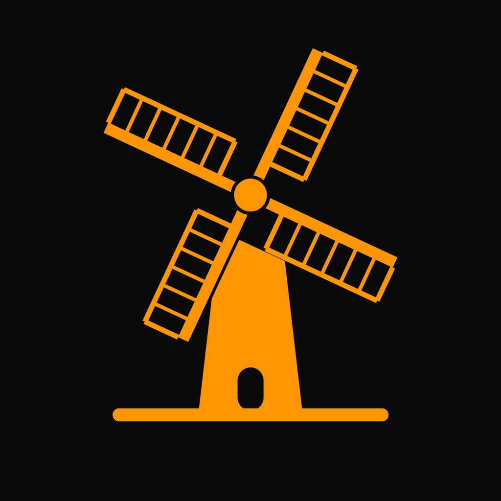
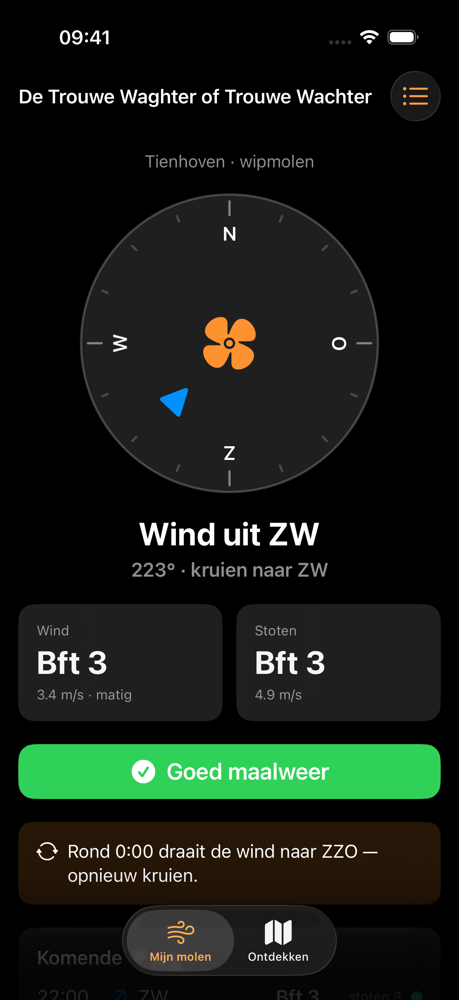
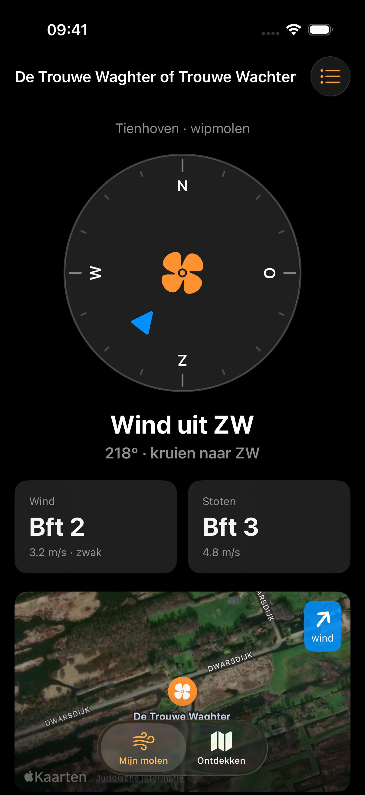
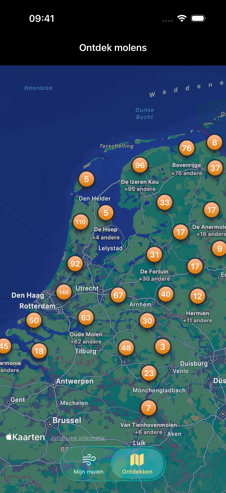
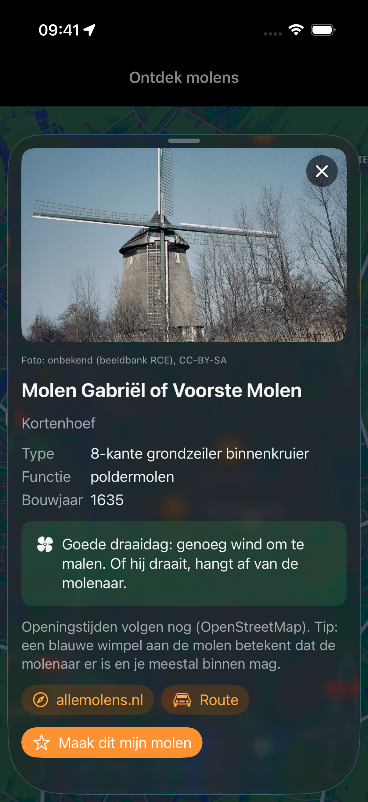

# Molenwind 🌬️

🔒 Laatste security check: 2026-11-21 18:29 CET



Gratis, open-source iPhone-app voor **molenaars** en **molenliefhebbers** in Nederland.

- **Mijn molen**, voor de molenaar: wind en windrichting op precies jouw molen, kruiadvies, windstoten,
  maalweer en een waarschuwing als de wind gaat draaien.
- **Ontdekken**, voor toeristen: ruim 1.200 bestaande windmolens op de kaart, met foto, type, bouwjaar en een
  indicatie of het vandaag een goede draaidag is.

Het idee komt van een gesprek met de molenaar in Ingen: *"wind is het allerbelangrijkste"*.

> Status: **v1.0 live in de App Store** sinds 18 november 2026 —
> [Molenwind in de App Store](https://apps.apple.com/nl/app/molenwind/id6836030027) · [website](https://cafferata.info/molenwind/)

<p>




</p>

## Functies
**Mijn molen**
- Kies je molen uit een zoekbare lijst; met je locatie staan de molens **in de buurt** bovenaan.
- **Windkompas**: waar de wind vandaan komt, en dus waarheen je kruit ("wind uit ZW, kruien naar ZW").
- Windkracht in Beaufort en m/s, **stoten** apart, en een maalweer-oordeel: te weinig wind, goed maalweer,
  stevig, stilzetten.
- Waarschuwing bij een **windomslag** van meer dan 45° in de komende 12 uur ("rond 0:00 draait de wind naar ZZO,
  opnieuw kruien").
- Verwachting per uur voor de komende 12 uur, en een satellietkaart die op je molen inzoomt, met windpijl.
- **Meldingen**: bij een windomslag (30 minuten vooraf) en bij harde wind (1 uur vooraf). Dit zijn lokale
  meldingen; iOS ververst de verwachting af en toe op de achtergrond. Er is geen server nodig.

**Ontdekken**
- Kaart met alle bestaande windmolens, gegroepeerd per regio; zoomt automatisch in op molens bij jou in de buurt.
- Molenpagina met foto, type, functie, bouwjaar, "goede draaidag"-indicatie, een link naar allemolens.nl en een
  route.
- **Openingstijden** uit OpenStreetMap, met "nu open/gesloten", in de taal van de gebruiker. De dekking is nog
  beperkt (37 molens); vul ze aan in [OpenStreetMap](https://www.openstreetmap.org) (`opening_hours`) en ze komen
  bij de volgende data-update in de app.

**Over**
- Vrijwillige fooien in molenstijl (☕ koffie voor de molenaar, 🌾 zak molenmeel, ⛵ nieuw zeil, 🪨 molensteen).
  Alle functies blijven gratis.
- "Steun de molens zelf": een link naar De Hollandsche Molen.
- Bronvermelding en disclaimer.

> De windinformatie is een **hulpmiddel**. De molenaar beslist zelf of en hoe er gedraaid wordt.

## Databronnen
| Wat | Bron | Licentie |
|---|---|---|
| Molens (locatie, naam, type, bouwjaar) | Rijksdienst voor het Cultureel Erfgoed (RCE), Landschapsatlas-WFS `Molens`, gebaseerd op gegevens van Vereniging De Hollandsche Molen | Publiek domein |
| Foto's | Beeldbank RCE, live geladen (niet in deze repo) | CC-BY-SA, met fotograaf |
| Wind | KNMI Harmonie (2 km) via [Open-Meteo](https://open-meteo.com) | CC-BY 4.0 |
| Openingstijden, websites | OpenStreetMap-bijdragers | ODbL |
| Kaarten | Apple Kaarten | — |

De app gebruikt **geen API-sleutels**, en er staan geen geheimen in deze repo.

## Talen
Nederlands, Engels, Duits, Frans en Spaans (`ios/Molenwind/Localizable.xcstrings`). Windrichtingen worden per taal
getoond (ZW → SW → SO). Molentypen uit de dataset (bijv. "stellingmolen") blijven Nederlandse vaktermen.

## Bouwen
Vereist Xcode 26 of nieuwer, iOS 18+.
```bash
cd ios
xcodebuild -project Molenwind.xcodeproj -scheme Molenwind \
  -destination 'platform=iOS Simulator,name=iPhone 17 Pro' CODE_SIGNING_ALLOWED=NO build
```
Op een eigen toestel: zet je eigen `DEVELOPMENT_TEAM` en bundle-ID in Xcode.

- Debug-startopties: `-startTab kaart|over`, `-toonMolen <Ten Bruggencate-nummer>`, `-toonKiezer YES`.
- Fooien lokaal testen: Xcode → Edit Scheme → Run → Options → StoreKit Configuration → `ios/Molenwind.storekit`.
- Logo opnieuw genereren: `python3 design/maak-logo.py <uit.png> <uit2.png>` (vereist Pillow).

## Repo-indeling
- `ios/`: SwiftUI-app (`Molenwind/`) met de molendata in `Resources/molens.json`
- `research/ONDERZOEK.md`: marktverkenning, databronnen en keuzes
- `research/rce_molens.geojson`: ruwe RCE-molendataset (1.872 molens, WGS84)
- `design/`: logo en het script dat het logo tekent
- `screenshots/`: schermafbeeldingen

## Nog te doen
Instelbare drempels per molen, widget en Apple Watch, een molenaarsknop "ik ben er nu" (live open), Android.

## Licentie
Code: [MIT](LICENSE). Data: zie de tabel hierboven.
